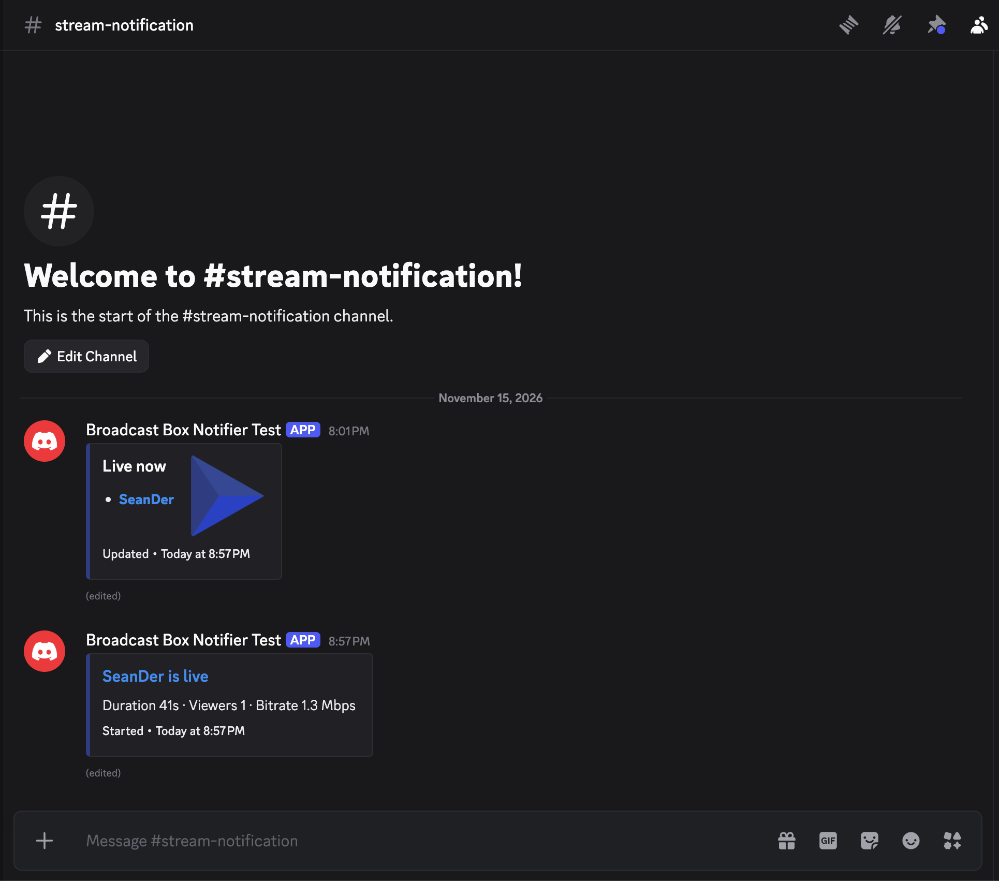

# Broadcast Box Stream Notifier

Notify your [Broadcast Box](https://github.com/Glimesh/broadcast-box) streams on Discord.
A lightweight notifier written in Go and deployed with Docker.

- A live dashboard with clickable links to streams.
- Individual stream cards showing duration, viewers, and video upload bitrate.
- Automatic updates and cleanup when streams end or stop sending data.
- Existing cards recovered after restarts.
- English and Simplified Chinese support.

<p align="left">
  
</p>

## Set Up a Discord Bot

1. Create an application in the [Discord Developer Portal](https://discord.com/developers/applications)
   and copy its bot token from the **Bot** page. Keep the token private.
2. In **OAuth2 → URL Generator**, select the **bot** scope and these permissions:
   **View Channels**, **Send Messages**, **Embed Links**, and **Read Message History**.
   Open the generated link to invite the bot to your server.
3. Choose a text channel and ensure the bot has those permissions there.
   Enable Discord's **Developer Mode**, then right-click the channel to copy its ID.

For a read-only notification channel, deny **Send Messages** to ordinary members and allow the bot's role.

## Deploy

You need an existing Broadcast Box instance and Docker Compose.
The image supports Linux `amd64` and `arm64`.

Use [compose.yaml](compose.yaml), replacing the three environment values:

```yaml
services:
  stream-notifier:
    image: ghcr.io/pharrio/stream-notifier:latest
    restart: unless-stopped
    environment:
      DISCORD_TOKEN: "YOUR_BOT_TOKEN"
      CHANNEL_IDS: "YOUR_CHANNEL_ID"
      BROADCAST_BOX_PUBLIC_URL: "https://stream.example.com"
    read_only: true
    cap_drop: [ALL]
    security_opt:
      - no-new-privileges:true
```

```sh
docker compose up -d stream-notifier
```

A dashboard will appear in the channel. Start a stream to see its live card;
cards update every 10 seconds by default and disappear after the stream ends.

### Connect to Your Existing Broadcast Box

The public URL is used for watch links. By default, it is also used to fetch
`/api/status`. If that endpoint is reachable directly, the Compose above is enough.

For internal access, add `BROADCAST_BOX_API_URL` with the appropriate **base URL**:

| Broadcast Box deployment | API URL | Compose setup |
| --- | --- | --- |
| Docker bridge network | `http://broadcast-box:8080` | Add [this service](examples/compose.bridge.yaml) to your stack; both containers must share a network. |
| Linux host network, including the official Compose | `http://127.0.0.1:8080` | Use [the host-network example](examples/compose.host.yaml). |
| Binary running on a Linux host | `http://127.0.0.1:8080` | Use the same host-network example. |

Adjust the hostname and port to match your installation. Keep
`BROADCAST_BOX_PUBLIC_URL` set to the address your viewers use.
Internal API access is useful when the public site sits behind a login proxy.

## Settings

Set these in the service's `environment` section. Only the first three are required.

| Variable | Default | Purpose |
| --- | --- | --- |
| `DISCORD_TOKEN` | Required | Discord bot token |
| `CHANNEL_IDS` | Required | Notification channel ID; comma-separated for multiple channels |
| `BROADCAST_BOX_PUBLIC_URL` | Required | Public watch-page base URL |
| `BROADCAST_BOX_API_URL` | Public URL | Separate base URL for status queries |
| `LANGUAGE` | `en` | `en` or `zh-CN` |
| `CHECK_INTERVAL_SECONDS` | `10` | Update interval, from 5 to 3600 seconds |
| `LOG_CHANNEL_ID` | Disabled | Separate channel for API failure and recovery notices |
| `DASHBOARD_THUMBNAIL_URL` | Official logo | Custom dashboard image URL |

## Update

```sh
docker compose pull stream-notifier
docker compose up -d --no-deps stream-notifier
```

Use the same Compose file arguments as during installation. After changing settings,
run the second command again to apply them.

## Troubleshooting

- **No messages:** check the bot token, channel ID, and channel permissions.
- **Status unavailable:** check that the notifier can reach Broadcast Box's
  `/api/status` without an interactive login. Prefer an internal API URL behind a login proxy.
- **Bot appears offline:** this is expected; the dashboard's update timestamp shows it is running.
- **Old or duplicate cards:** check Read Message History permission and run only one notifier
  instance for the same bot and channels.

Check logs with `docker compose logs --tail 100 stream-notifier`.

## License

[MIT](LICENSE). Third-party license notices are included in [third_party](third_party/).
The thumbnail uses the [official Glimesh mark](https://github.com/Glimesh/glimesh.tv/blob/1fb679f0dcc04154034a6b73e7b52ac2677493f1/priv/static/images/logos/logo-no-text.png).
This project is not affiliated with Discord, Glimesh, or Broadcast Box.
